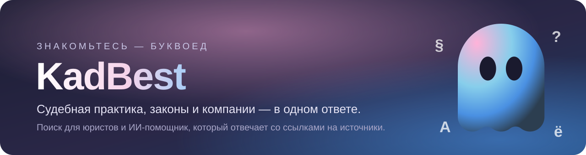
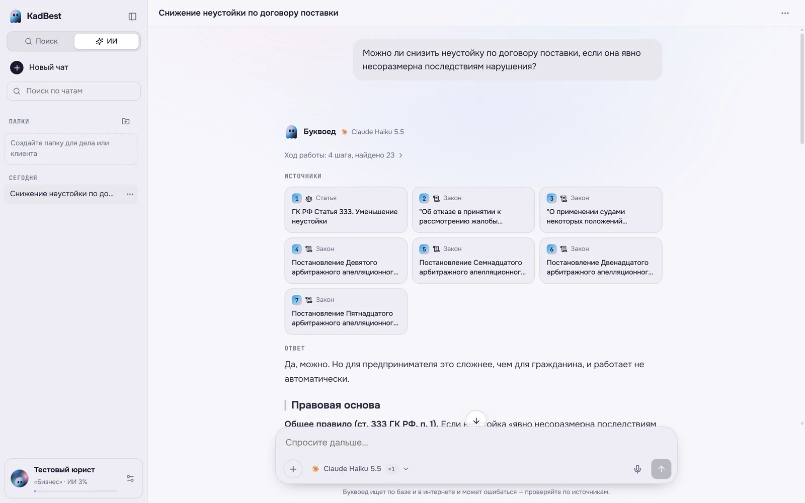
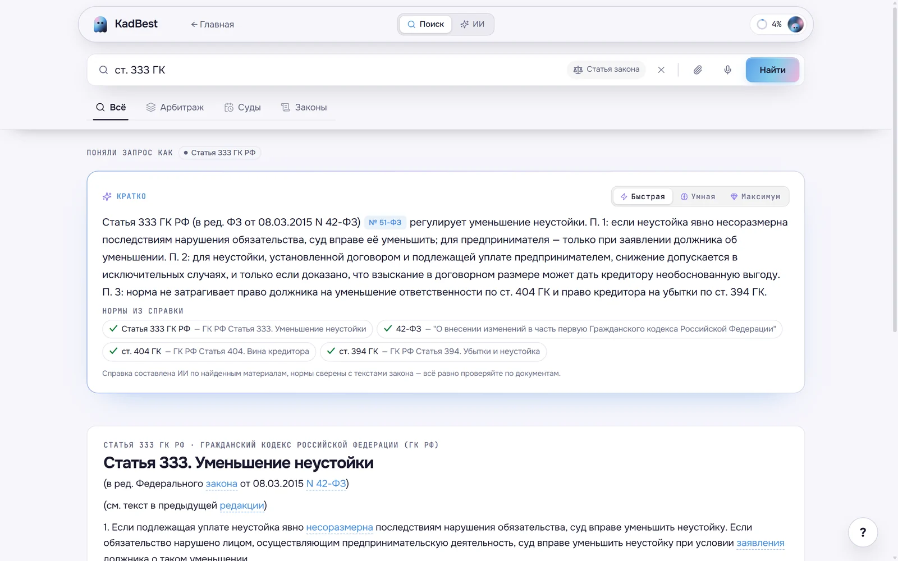
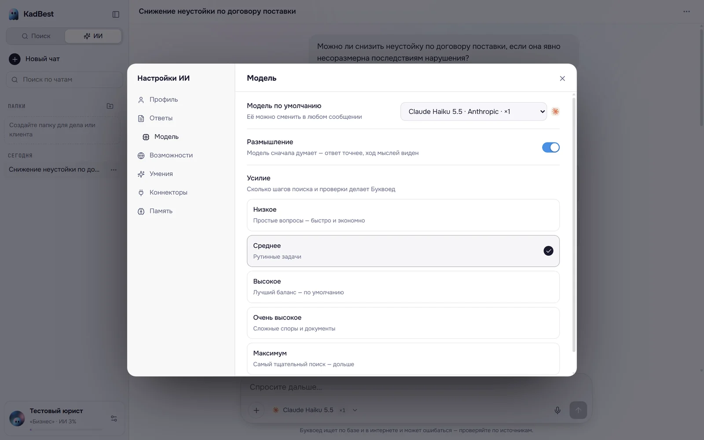
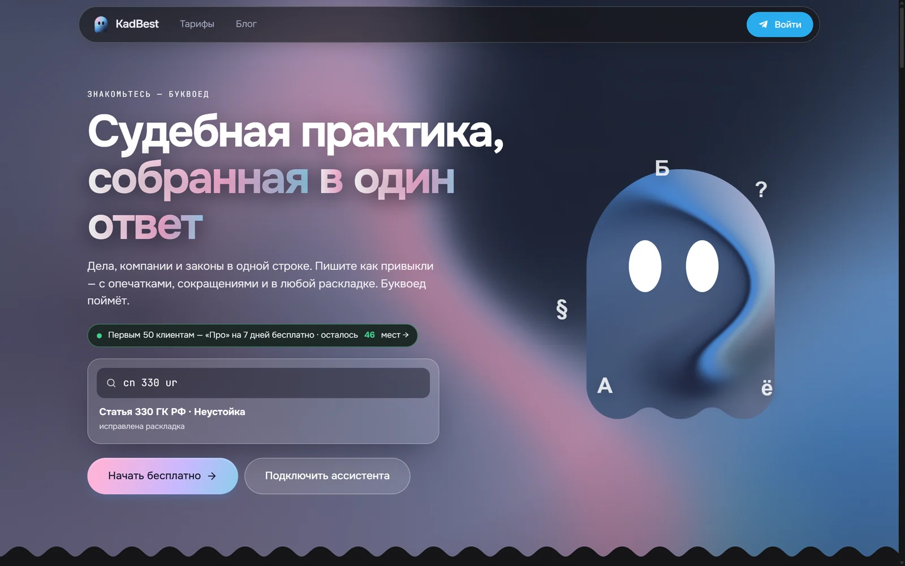
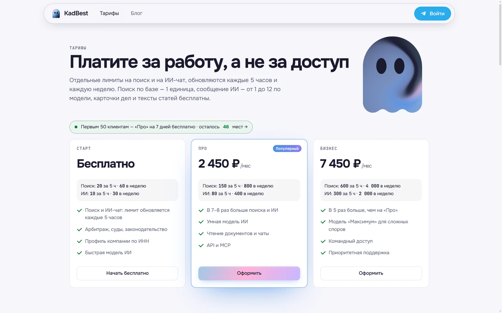
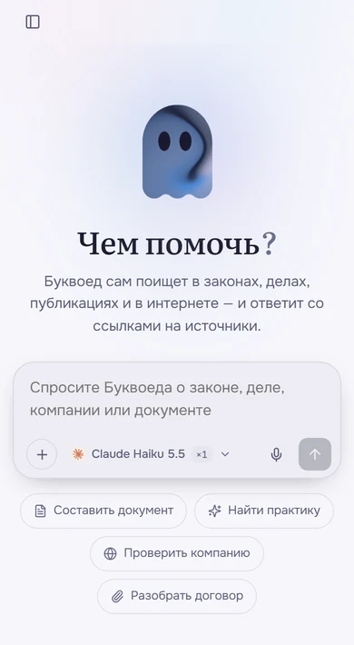
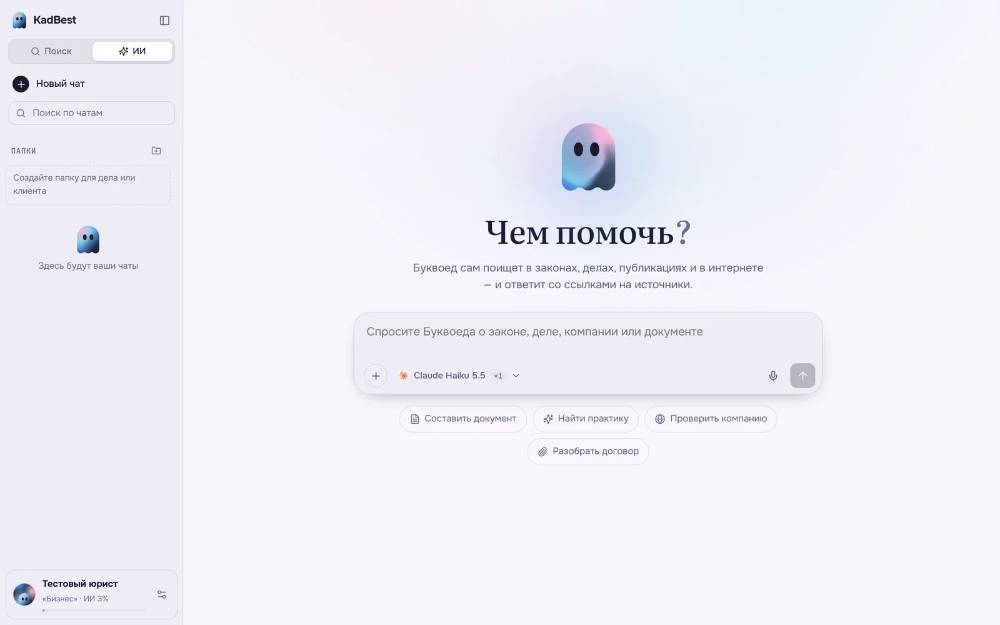

<p align="center">
  <a href="https://kadbest.online"></a>
</p>

<p align="center">
  <a href="https://kadbest.online"></a>
  
  
  
  
</p>

<p align="center">
  <a href="https://kadbest.online">Сайт</a> ·
  <a href="https://kadbest.online/#/changelog">Что нового</a> ·
  <a href="https://kadbest.online/#/roadmap">Планы</a> ·
  <a href="https://kadbest.online/#/pricing">Тарифы</a> ·
  <a href="https://kadbest.online/#/blog">Блог</a>
</p>

---

**KadBest** — сервис для юристов. Одна строка ищет по арбитражным делам, судам общей юрисдикции,
законам и компаниям, а ИИ-помощник **Буквоед** сам собирает материалы и отвечает со ссылками
на источники. В этом репозитории — открытая часть: интерфейс сайта, клиенты API и SEO-сборка.

<p align="center">
  <picture>
    <source media="(prefers-color-scheme: dark)" srcset="docs/ai-answer-dark.webp">
    
  </picture>
</p>

## Что умеет

### 🤖 Буквоед — ИИ-помощник

- **Отвечает со ссылками.** Сам ищет в законах, статьях кодексов, делах и публикациях. Источники видны карточками над ответом, а `[1]` `[2]` в тексте открывают документ.
- **Модели на выбор.** Claude, GPT, Grok и DeepSeek. У каждой видно, во сколько раз она расходует лимит.
- **Размышления.** Ответ печатается вживую, ход мыслей можно развернуть, генерацию — остановить.
- **Умения.** Претензия, иск, отзыв, договор, проверка контрагента, заключение, ходатайство, а также свои.
- **Документы Word.** Готовит документ по правилам оформления и отдаёт `.docx`.
- **Точные расчёты.** Дни просрочки, проценты и неустойку считает калькулятор, а не модель «на глаз».
- **Долгая память** (только с согласия), **коннекторы MCP**, **голосовой ввод**, файлы в чате.

### 🔎 Поиск

- Понимает номер дела, ИНН, «ст. 330 ГК», «159-ФЗ» и вопрос обычными словами.
- Русская морфология, юридические синонимы и сокращения, исправление опечаток и раскладки.
- Краткая справка ИИ, в которой нормы сверены с текстом закона.

<table>
  <tr>
    <td width="50%"></td>
    <td width="50%"></td>
  </tr>
  <tr>
    <td align="center"><sub>Поиск: текст статьи и справка ИИ со сверенными нормами</sub></td>
    <td align="center"><sub>Настройки ИИ: модель, размышление, пять уровней усилия</sub></td>
  </tr>
  <tr>
    <td width="50%"></td>
    <td width="50%"></td>
  </tr>
  <tr>
    <td align="center"><sub>Главная страница</sub></td>
    <td align="center"><sub>Тарифы: отдельные лимиты на поиск и ИИ</sub></td>
  </tr>
</table>

<p align="center">
  
  &nbsp;&nbsp;
  
</p>

## Что в репозитории

| Папка | Что это |
|---|---|
| [`frontend/`](frontend) | Сайт на React 18 + Motion, сборка Vite: поиск, ИИ-чат, настройки, тарифы, блог |
| [`clients/`](clients) | Клиенты API KadBest на JavaScript (`lexapi.mjs`) и Python (`lexapi.py`) без зависимостей |
| [`ops/seo/`](ops/seo) | Обложки статей блога и статичные страницы для поисковиков |

Серверная часть закрыта: источники данных, обработка запросов, ИИ-логика и лимиты. Интерфейс
работает с API KadBest.

<details>
<summary><b>Главные файлы интерфейса</b></summary>

| Файл | Что внутри |
|---|---|
| `AIMode.jsx` | ИИ-чат: панель чатов и папок, поток ответа, источники, документы, строка ввода |
| `AIExtras.jsx` | Меню «+», настройки размышления, голосовой ввод, карточка документа, коннекторы |
| `AISettings.jsx` | Окно «Настройки ИИ»: профиль, ответы, модель, умения, коннекторы, память |
| `ModelMenu.jsx` | Выбор модели по провайдерам с коэффициентом лимита |
| `Service.jsx` | Страница поиска: выдача по разделам, карточки, справка ИИ |
| `Md.jsx` | Markdown-ответы: ссылки на источники и нормы, эффект печати |
| `Mascot.jsx` | Буквоед — персонаж сайта |
| `styles.css` | Все стили: токены цвета, светлая и тёмная темы, анимации |

</details>

## Запуск интерфейса

```bash
cd frontend
npm ci
npx vite        # http://127.0.0.1:5173
```

Запросы `/v1` и `/mcp` dev-сервер проксирует на `127.0.0.1:8090`. Без сервера KadBest интерфейс
откроется, но поиск и чат работать не будут.

## API

Ключ выдаётся в личном кабинете на [kadbest.online](https://kadbest.online/#/integrations).
Там же есть инструкции по подключению KadBest к Claude, ChatGPT и Cursor по MCP.

```js
import { Lex } from './clients/lexapi.mjs';

const kb = new Lex('https://kadbest.online', { key: 'kb_…' });
const r = await kb.answer('ст. 330 ГК');            // несколько блоков ответа
const art = await kb.lawArticle('330', { code: 'ГК' });
```

```python
from lexapi import Lex

kb = Lex("https://kadbest.online", key="kb_…")
for a in kb.answer("ст. 330 ГК")["answers"]:
    print(a["type"], a["title"])
```

## Как устроен этот репозиторий

Репозиторий автоматически синхронизируется из основного с помощью
[Copybara](https://github.com/google/copybara): каждая синхронизация — один коммит со ссылкой на
исходную ревизию (`GitOrigin-RevId`). Изменения напрямую сюда не вносятся. Если нашли ошибку
в интерфейсе, напишите в [Issues](../../issues).

---

<p align="center"><sub>© KadBest. Код открыт для ознакомления, все права защищены.</sub></p>
